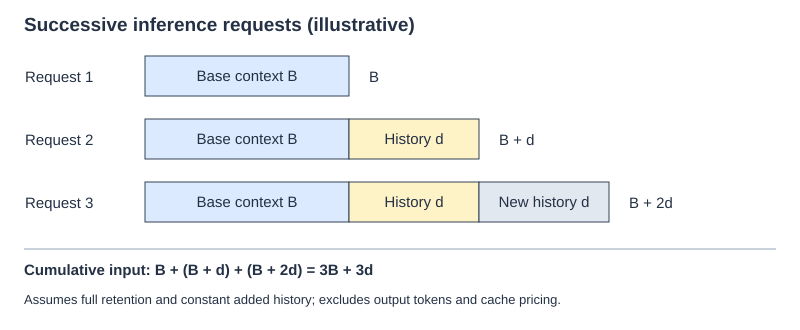

### 2.4 Token Consumption and Computational Efficiency

The login issue introduced in Section 2.1 illustrates why the resource requirements of coding agents extend beyond generating a code change. An agent may need to inspect the authentication implementation, investigate its dependencies, edit the relevant files and execute tests before the developer accepts the change. Each of these activities can involve further model interactions. This section examines how such interactions contribute to resource consumption, how previous studies attempt to manage it, and how computational resource use can be evaluated in the two workflows considered in this study.

#### 2.4.1 Sources of Token Consumption in Agent-Assisted Development

As described in Section 2.1.1, an agent can alternate between model inference and actions in its environment. A model request receives input tokens, including instructions and selected information about the task, and produces output tokens, which may include text, code or tool-call arguments. A tool response, such as the contents of a source file or a test failure, can then become part of the input to a subsequent request. Consequently, task-level token consumption is the cumulative usage across model requests, rather than the length of a single prompt or the number of tokens in the final code.

Figure 2.X illustrates this distinction using a simplified execution sequence. Let B denote the initial input size and d the amount of new history retained after each interaction. If the entire history is supplied again without compaction and d remains constant, the input to request i is B + (i − 1)d. The cumulative input over n requests is therefore nB + dn(n − 1)/2. The quadratic term concerns accumulated input over the task, not the size of any individual request, and depends on the assumed retention policy. Actual agents may truncate, mask, summarise or retrieve information selectively.

*Figure 2.X. Illustrative accumulation of input tokens across successive model requests. Author's illustration based on the iterative execution model of Yao et al. (2023) and the context-accumulation discussion of Fan et al. (2025). B is initial input and d is newly retained history per interaction; the illustration is not measured usage.*

Fan et al. (2025) observe growing prompt histories in agent trajectories and describe the repeated ingestion of earlier material as a source of cumulative token use. Bai et al. (2026), analysing eight models on SWE-bench Verified, similarly identify input rather than generated output as the dominant contributor to usage in their agentic coding setting. They report differences of up to thirtyfold in token counts between executions of the same task. These observations indicate that final output length alone is insufficient to characterise the resources used during agent execution.

Context accumulation is not necessarily redundant. Earlier findings may be needed for a later change or verification step. However, a file that is unrelated to the current action, a lengthy command result or instructions that duplicate information already supplied can enlarge subsequent requests without providing correspondingly useful information. This is related to the context-utilisation problem in Section 2.3 but concerns the quantity of input processed rather than whether the model correctly uses the information. The studies of repository-level instruction files discussed in Section 2.1.3 illustrate why the value of additional context must be assessed empirically: Lulla et al. (2026) report lower output-token usage with instructions but no statistically significant difference in total usage, whereas Gloaguen et al. (2026) report increased inference expenditure without a general improvement in task success.

Another source of resource consumption is repeated execution. An agent resuming the login issue may need to rediscover which shared authentication helper was inspected and which application remains untested. KC and Budathoki (2026) show that making information about an interrupted agent's work available to a successor can reduce the effort of resuming repository tasks. Repetition can also arise when an implementation fails, a tool call returns an error or a developer requests corrections. Fan et al. (2025) report substantially higher resource consumption for unsuccessful attempts in several evaluated scaffold–model combinations. This does not establish that all unsuccessful attempts were avoidable: investigation and correction are often necessary parts of resolving an issue.

Structured workflows introduce their own activities. A planning step may generate an intermediate representation of the work; a separate agent may receive a task description and repository context; and a validation step may return results for further model analysis. Generating or refreshing a task summary can also require inference. Fan et al. (2026) investigate planning, tool interfaces and context policies through component-level comparisons, showing that their resource effects depend on the model and execution conditions. Table 2.X summarises the main sources discussed here, separating the mechanisms from the outcomes that would need to be observed to establish inefficiency.

*Table 2.X. Sources of model resource consumption in agent-assisted development (author's synthesis).*

| Source | How consumption arises | Relevant evidence / qualification |
| --- | --- | --- |
| Context accumulation | Retained instructions, code and observations enter successive requests. | Fan et al. (2025); Bai et al. (2026). Retention can be necessary. |
| Additional context | Retrieved code or repository instructions enlarge a request. | Lulla et al. (2026); Gloaguen et al. (2026). Effects depend on relevance and subsequent actions. |
| State reconstruction | Earlier findings are recovered by searches, reads or renewed analysis. | KC and Budathoki (2026). Their evidence concerns interrupted tasks. |
| Repeated execution | Further inference follows failed actions, patch attempts or test results. | Fan et al. (2025); Gao and Peng (2026). Necessary correction must be distinguished from unproductive repetition. |
| Orchestration activities | Planning, handoffs, summaries and model-assisted verification introduce additional processing. | Fan et al. (2026); Lindenbauer et al. (2025). The net effect of a mechanism is conditional; stage-level costs are not measured in this study. |

Token counts also differ from monetary expenditure. Input and output may be charged at different rates, and repeated input prefixes may be eligible for discounted caching. Yang et al. (2026) demonstrate that changes in context can alter both cache reuse and subsequent agent behaviour. A reduction in logical input length therefore need not reduce the bill. Local execution of a deterministic test consumes computational resources but need not itself use model tokens; feeding its results to a model is a separate activity. The study's use of gateway token counts and recorded charges should thus not be interpreted as measurement of total hardware, infrastructure or labour cost.

The conventional prompt-based workflow in this study uses Claude Code, which already provides repository tools and native context management, including compaction (Anthropic, n.d.-a). The structured workflow changes how task-level activities are organised, rather than introducing agent capabilities into a system that lacks them. The mechanisms described above provide several opportunities to manage resource use, but do not establish which workflow consumes fewer resources. The following section examines approaches that have been evaluated in prior research.

<!-- REVIEW TODO: Renumber Figure 2.X and Table 2.X after Chapter 2 assembly. Check gateway cache accounting in Chapter 3 before making any claims about cached versus uncached usage in the study. -->
