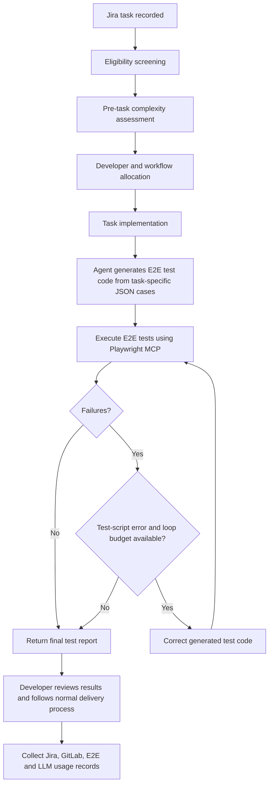

#### 4.1.4 Experimental Procedure

The experiment was embedded in the team's normal development process over 12 weeks. Each eligible Jira task was completed once using one of the two workflow conditions. The sequence below describes how tasks entered the study, how each workflow was applied, and how development outcomes were recorded.

1. **Task identification and screening.** Requirements, bug fixes, and refactoring tasks were recorded in Jira and screened against the front-end task criteria described in Section 4.1.2. Traceability to GitLab changes was checked when collecting records for the completed task.
2. **Pre-task classification and assignment.** Before implementation, the technical lead assessed the expected effort, scope, and dependencies and classified the task as simple, medium, or complex. The lead assigned a developer and one workflow condition, aiming to balance the two conditions within each participating developer and complexity category while respecting normal delivery requirements.
3. **Implementation.** The assigned developer carried out the task using either the baseline or Trade-Harness. Both conditions used Claude Code CLI with Claude Sonnet 4.6 and followed the same applicable software development requirements. The difference was whether the developer coordinated activities with prompts and native agent tools or Trade-Harness organized them through its predefined workflow stages.
4. **E2E test execution.** The agent received the JSON test-case document associated with that task, generated the corresponding E2E test code, and executed it through Playwright MCP. Each task had its own test cases; the same task and test-case content were not executed as a repeated comparison under both conditions.
5. **Test-script correction and result reporting.** Following an E2E run with failures, the agent examined the failed cases to determine whether the generated test code was incorrect. When a test-script problem was identified, it could revise the test code and rerun the tests, for a maximum of three correction loops. This loop was not intended to modify business code or alter the task's test-case requirements to obtain a passing result. The baseline was given the three-loop rule through developer prompts or project instructions; Trade-Harness applied the same limit through its workflow controls. Once testing completed or the loop limit was reached, the agent returned the resulting test report, including any unresolved failures, for developer review and handling through the normal delivery process.
6. **Data collection.** Task status transitions, repository changes, available test reports, and model usage records were linked to the corresponding Jira task for subsequent analysis. Section 4.2 defines the measurements, data extraction, and processing procedures.

*Figure 4.1 Experimental Procedure*

The loop limit standardizes the intended number of test-script correction attempts, but its implementation differs between conditions: a prompt-level instruction in the baseline and an explicit workflow rule in Trade-Harness. The reported E2E outcome reflects the results remaining after the permitted testing procedure, not a separate repeat of the same development task under the alternative workflow. The approach does not by itself isolate the effect of context or memory management; the analysis evaluates the outcomes of the complete workflow comparison.
